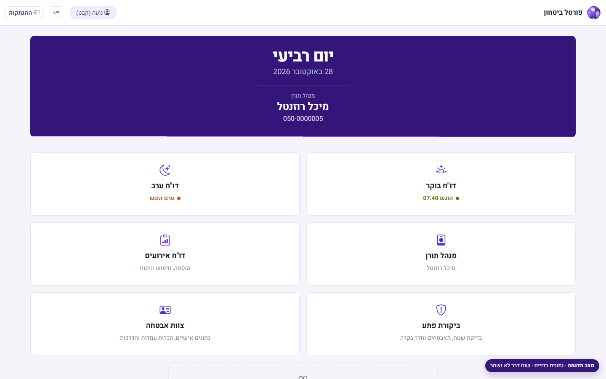
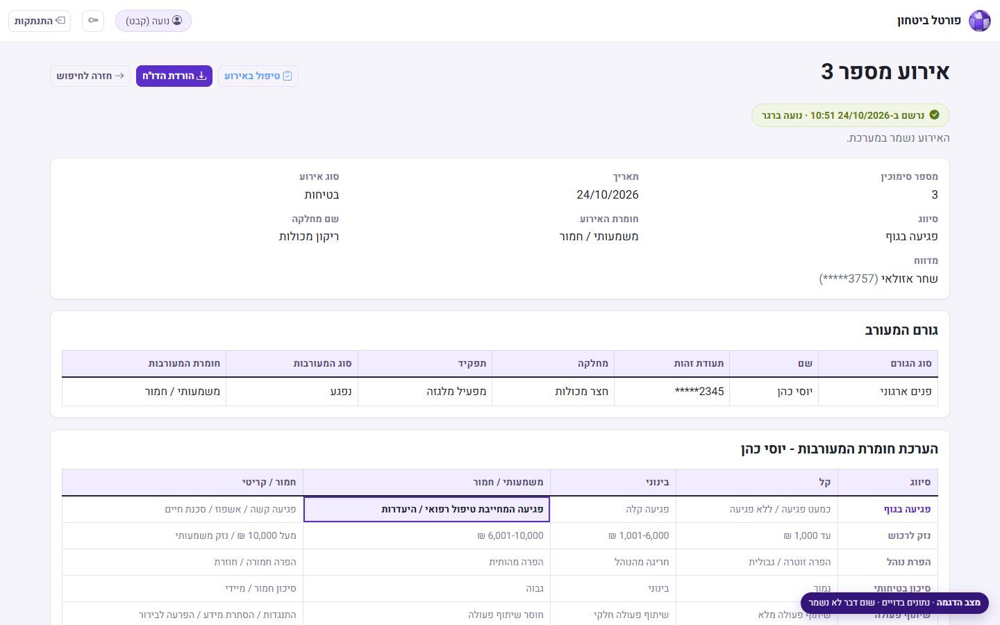
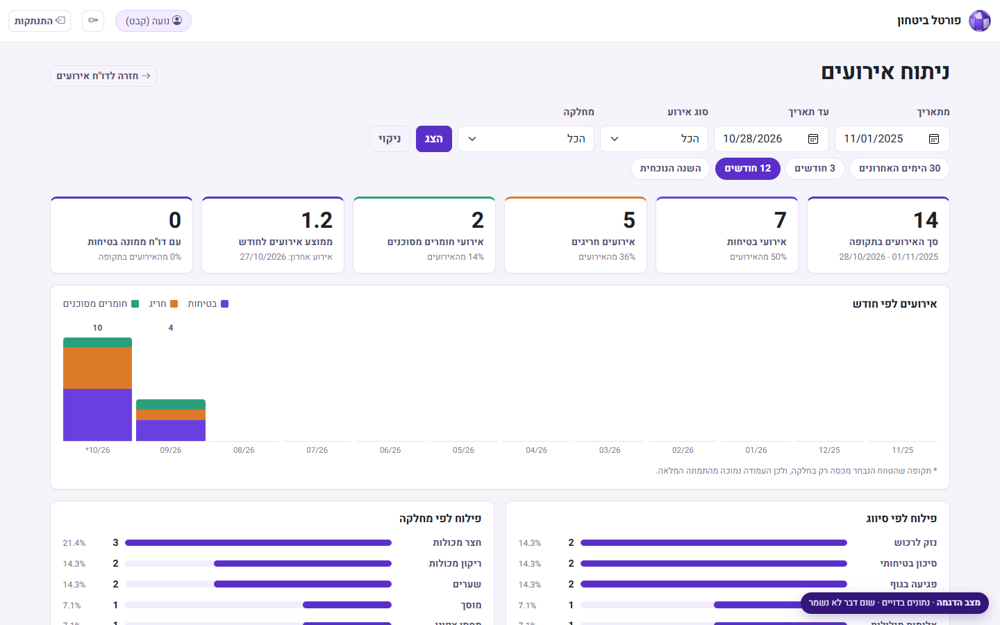
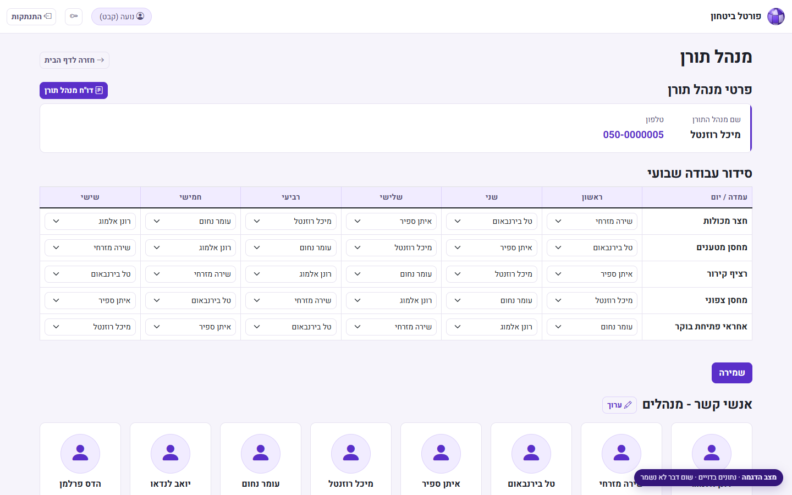
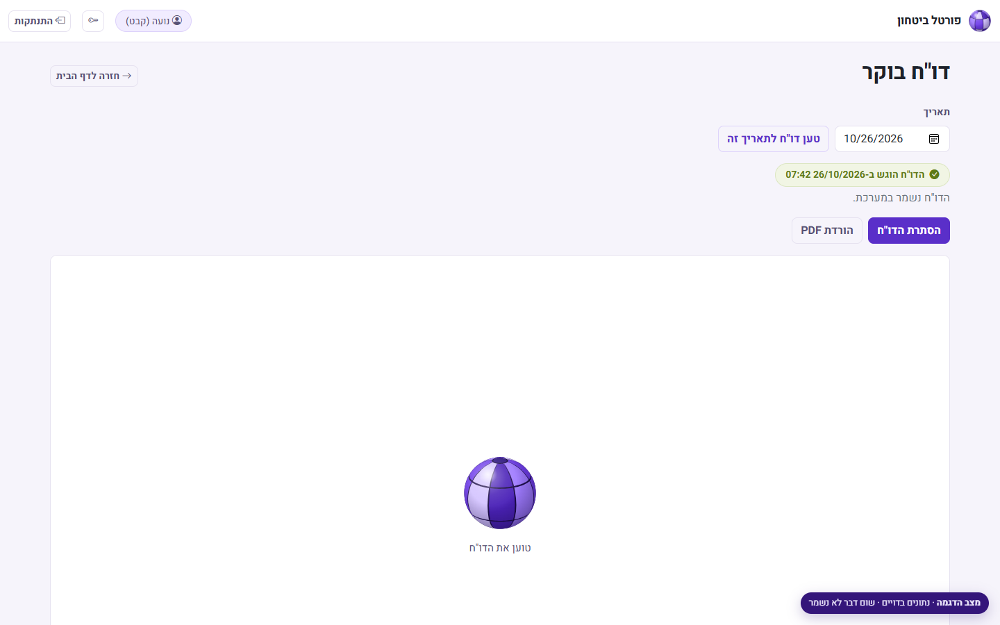
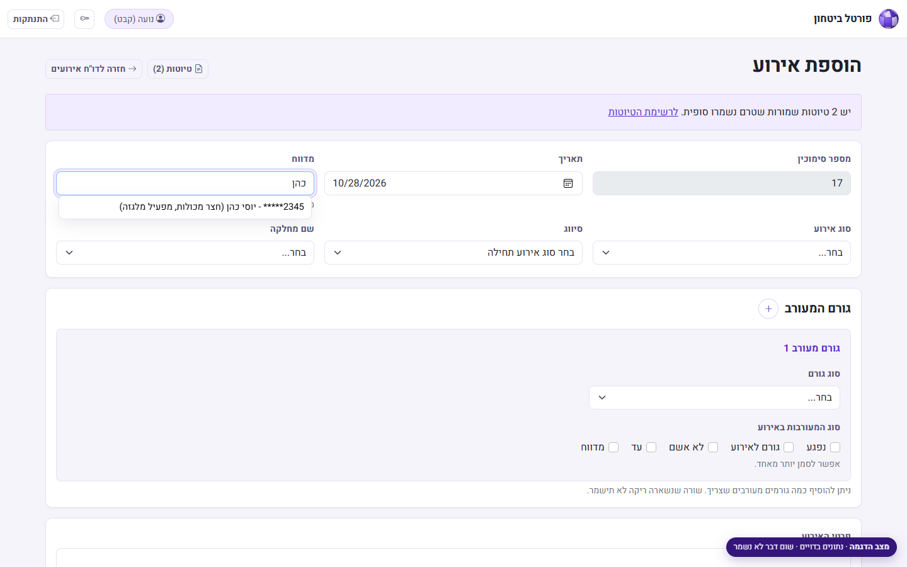
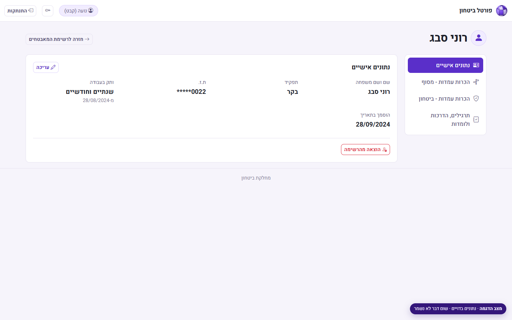
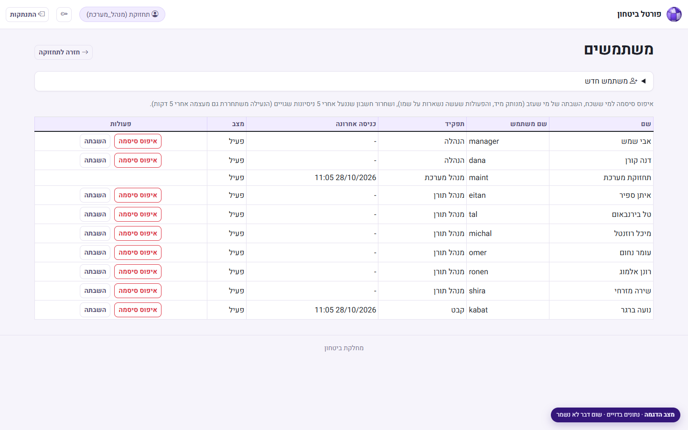

# Security Portal: daily operations for a terminal's security department

The internal web portal a container terminal's security department runs its day on: morning and
evening reports, incident reporting and analysis, the duty-manager roster, surprise inspections,
and the guards' training folders. Hebrew, right-to-left, and it works at phone width as well as on the desktop.

**[Live demo →](https://MrCuteFace.github.io/security-portal/)**: sign in with either demo user.

**In daily production use.** Because it is a working security system, this repository contains
**a static demo only** (no server code).
Every page in it was rendered by the real application against an invented data set, then saved as
HTML. People, IDs, phone numbers, departments, posts and branding are all made up.



## What the portal does

| Area | What it covers |
|---|---|
| **Morning / evening reports** | Checklists for terminal opening, operations, posts and closing; one report per day, locked once submitted, rendered to PDF and mailed to a recipient list. |
| **Incidents** | Three incident types (safety, exceptional, hazardous materials), each with its own classifications. Internal and external parties, a severity grid per party with a suggested severity and a required reason to override it, Word report preview, photo and video attachments, drafts. |
| **Analysis** | Totals, monthly trend by type, and breakdowns by department and classification over a chosen range. |
| **Duty manager** | Weekly roster per post, contact cards, a daily report, and a certification form signed on screen and stamped into a PDF. |
| **Surprise inspections** | Night-time checklist of the area, guards and control room, with findings and PDF export. |
| **Guards** | Personal details and a training folder per guard: post familiarization, drills and courses, with refresh dates. |
| **Maintenance** | Users and roles, password resets, lockouts, mail recipient lists, and importing the employee directory from Excel with a preview before applying. |



## Under the hood

- **ASP.NET Core 8 MVC** with EF Core on SQL Server; schema managed with versioned SQL scripts.
- **Role-based access:** security officer, management (read-only), duty managers, system admin. Each screen and action is scoped to the roles that need it.
- **Security hardening:**
  - Login rate limiting and account lockout.
  - A password policy.
  - Cookie sessions re-validated against the database on every request, so a password change or role change takes effect immediately.
  - National ID numbers masked everywhere they are shown, with support for encrypting them at rest (SQL Server Always Encrypted).
  - ID lookups sent by POST, so they never land in URLs or logs.
  - Anti-forgery tokens and hardening headers (CSP, frame and referrer policy).
- **Reports as PDFs** with QuestPDF, **mail** through Microsoft Graph, and incident videos stored outside the database.
- **Forms built for real use:** confirmation before a report is locked, server-side validation mirrored in the browser, and drafts for incidents that are still being investigated.

| | |
|---|---|
|  |  |
|  |  |
|  |  |

## How this demo was made

1. A copy of the app ran locally against a throwaway database, with mail disabled.
2. Site-specific content was replaced: the real checklist wording, posts, departments and people.
3. The database was seeded with two weeks of invented activity.
4. A crawler signed in as each demo user, saved every page as the server rendered it, and saved the PDFs it generated.
5. A build step rewrote the links between pages and added a small demo layer (`site/demo/`).

The demo layer:
- Lets either demo user "sign in".
- Routes date pickers and search to the saved pages.
- Answers the incident form's live employee search from the invented directory.
- Lets the page's own confirmations and validation run, then shows a note instead of saving.

The purple puzzle-sphere logo and its loading animation are an invented mark used across these demos.

## Running it

It's a static site, so any file server works:

```bash
cd site
npx serve .        # or: python -m http.server
```

Pushing to `main` publishes `site/` to GitHub Pages ([workflow](.github/workflows/pages.yml)).
